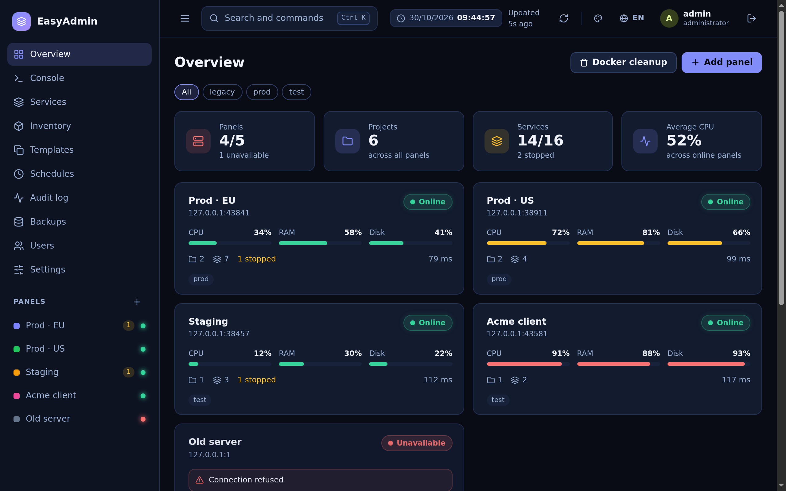
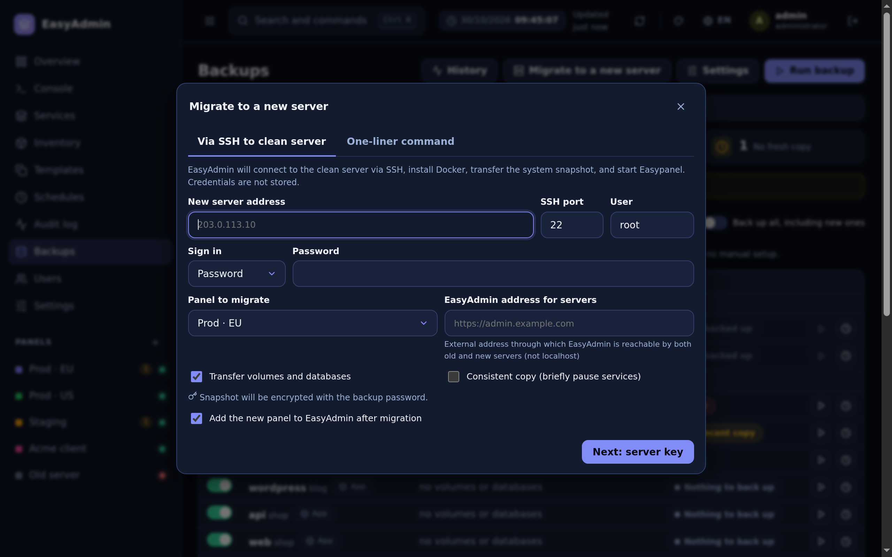
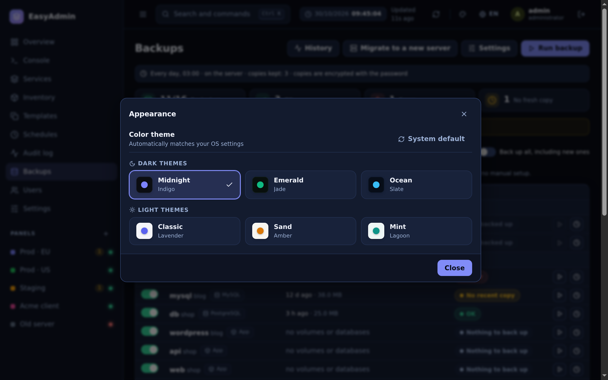
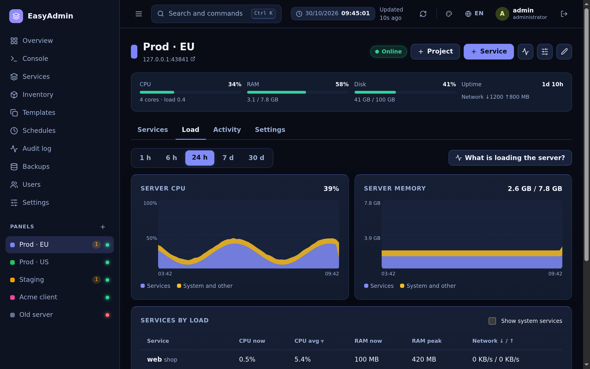
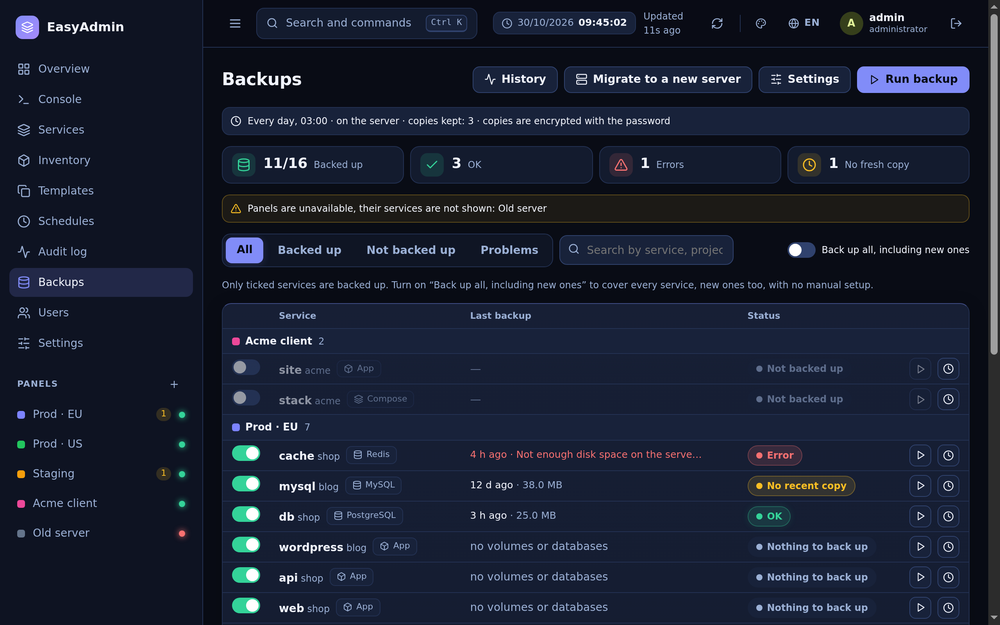
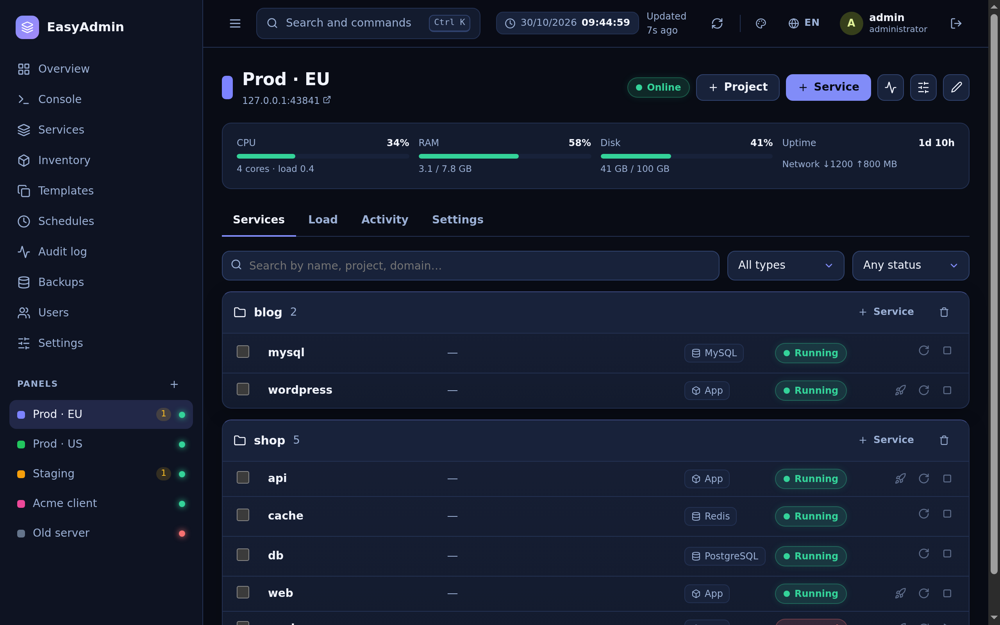

<div align="center">

# 🐴 EasyAdmin

### Unified Multi-Server Control Plane for [Easypanel](https://easypanel.io)

**Manage 10–50+ Easypanel servers, Docker clusters, databases, and services from a single, blazing-fast web console.**  
Zero runtime dependencies • Zero frontend build • 100% self-hosted • Boots in 100ms • Uses < 30MB RAM

[](LICENSE)
[](package.json)
[](Dockerfile)
[](#-zero-build-architecture)
[](#)
[](README.ru.md)

[**Live Demo**](#-interactive-demo) • [**Quick Start**](#-quick-start-in-60-seconds) • [**Features**](#-features) • [**Migration**](#-1-click-server-migration) • [**Screenshots**](#-screenshots) • [**Security**](#-security)

</div>

---

## 📸 Screenshots

| Overview Dashboard | 1-Click Server Migration |
|:---:|:---:|
|  |  |

| 6 Built-in Themes (Dark & Light) | Live Load Monitoring |
|:---:|:---:|
|  |  |

| Backups & Disaster Recovery | Panel & Projects Control |
|:---:|:---:|
|  |  |

---

## ⚡ Why EasyAdmin?

Easypanel is fantastic for managing a single VPS. But when you run **3, 10, or 25+ servers**, switching browser tabs, checking separate login sessions, and repeating maintenance tasks across panels becomes tedious.

**EasyAdmin connects all your Easypanel instances into one command center:**
- **Zero Tab Fatigue**: View status, CPU, memory, and disk across all servers in one unified overview.
- **1-Click Full Server Migration**: Move an entire server (Easypanel, SSL certificates, Git deploy keys, configurations, volumes, and databases) to a clean Ubuntu/Debian server via SSH or a single curl command.
- **Unified Backups & Restores**: Centralized database dumps (Postgres, MySQL, MariaDB, Mongo, Redis) and volume copies with encryption, S3 rotation, and a step-by-step restoration wizard.
- **Bulk Operations**: Mass deploy/restart, bulk environment variable updates, and batch image version rollouts across multiple servers simultaneously.
- **6 Modern Color Themes**: 3 Dark (Midnight Indigo, Emerald Jade, Deep Ocean Slate) and 3 Light (Classic Lavender, Warm Sand, Mint Breeze) with instant top-bar switching.
- **Integrated Terminal**: Embedded xterm.js console for both service containers and the host server itself — no open SSH ports needed.
- **Zero Build, Zero Bloat**: Built with native Node.js (`node:sqlite`, `node:crypto`) and standard vanilla ES modules. No webpack, no npm build, no 500MB `node_modules`.

---

## 🚀 Quick Start in 60 Seconds

### Docker Compose (Recommended)

Create `docker-compose.yml`:

```yaml
services:
  easyadmin:
    image: ghcr.io/its-my-work/easyadmin:latest # or build: .
    container_name: easyadmin
    restart: unless-stopped
    ports:
      - "3100:3100"
    environment:
      - PORT=3100
      - HOST=0.0.0.0
      - EASYADMIN_SECRET=generate_with_openssl_rand_hex_32
      - EASYADMIN_SECURE_COOKIES=false # Set true behind HTTPS reverse proxy
    volumes:
      - ./data:/app/data
```

Run:

```bash
docker compose up -d
```

Open **`http://localhost:3100`** in your browser. On first launch, create your administrator account, then connect your first Easypanel via URL + API token (or panel login).

### Docker CLI One-Liner

```bash
docker run -d \
  --name easyadmin \
  --restart unless-stopped \
  -p 3100:3100 \
  -v easyadmin_data:/app/data \
  -e EASYADMIN_SECRET="$(openssl rand -hex 32)" \
  node:22-alpine \
  sh -c "git clone https://github.com/Its-My-Work/easyadmin.git /app && cd /app && npm start"
```

### Direct on Host (Node.js ≥ 22.13)

```bash
git clone https://github.com/Its-My-Work/easyadmin.git
cd easyadmin
npm start # Opens on http://localhost:3100
```

---

## 🎮 Interactive Demo

Want to test EasyAdmin right now without connecting real servers? Run the built-in mock demo cluster:

```bash
npm run demo
```

Open **`http://localhost:3100`** and sign in with `admin` / `demo12345`. You'll get 5 simulated production servers with mock load, services, and backups.

---

## ✨ Features

### 🌐 Fleet Management & Overview
- **Global Overview**: Real-time health check, status pills (Online, Degraded, Offline), CPU/RAM/Disk metrics across all clusters.
- **Tag Filtering & Fast Search**: Group panels by environment (`prod`, `staging`, `client`), search with `Ctrl+K` or `/`.
- **Global Docker Cleanup**: Prune unused images and build caches across several panels in one click.

### 🚀 1-Click Server Migration
- **Zero-Friction Server Transfer**: Move from one cloud provider to another or upgrade your VPS in minutes.
- **Two Migration Modes**:
  1. **Direct SSH**: EasyAdmin connects to a clean server, verifies OS requirements, installs Docker & Swarm, transfers encrypted data, and spins up Easypanel automatically.
  2. **One-Liner Command**: EasyAdmin generates a single secure command (`curl -sSL .../bootstrap.sh?token=... | bash`) to execute as root on the target server.
- **Complete Parity**: Preserves all Easypanel configurations, Let's Encrypt SSL certificates, Git SSH deploy keys, persistent volumes, and databases with optional consistency pausing.

### 🎨 6 Beautiful Built-in Themes
- **3 Dark Themes**:
  - 🌌 **Midnight (Indigo)**: Deep dark `#090c15` background with soft violet-indigo accents.
  - 🌿 **Emerald (Jade)**: Rich dark coniferous green `#06110c` with radiant emerald highlights.
  - 🌊 **Deep Ocean (Slate)**: Deep navy `#06101e` with electric cyan accents.
- **3 Light Themes**:
  - ☀️ **Classic (Lavender)**: Crisp cool slate-white `#f5f7fc` with high-contrast typography.
  - 🏜️ **Warm Sand (Amber)**: Gentle warm cream `#f9f6ef` with golden amber accents.
  - 🍃 **Mint Breeze (Lagoon)**: Fresh maritime teal `#eef7f5` with seafoam accents.
- **Instant Switcher**: Click the palette icon in the top navigation bar or toggle in the Profile settings. Automatic OS system theme detection supported.

### 💾 Disaster Recovery & Backups
- **Comprehensive Backups**: Direct database dumps (PostgreSQL, MySQL, MariaDB, MongoDB, Redis) and file volumes.
- **Local & S3 Storage**: Store copies on the panel host or upload directly to AWS S3, Cloudflare R2, MinIO, or Backblaze with automated retention rotation.
- **Step-by-Step Restore Wizard**: Restore into the same service, an existing service, or automatically provision a new matching service. Includes automatic safety copies before overwriting data.
- **Unified History**: Clean modal tab combining backup run logs and restore history.

### ⚡ Mass Operations & Inventory
- **Interactive Table Sorting**: Click table headers on Services, Backups, and Users pages to sort dynamically.
- **Dedicated Project Column**: Clear organization by project with responsive screen scaling.
- **Bulk Environment Variables**: Add, modify, or remove env keys across 20+ services at once while preserving comments.
- **Bulk Image Updates**: Roll out new container image tags across multiple services and clusters simultaneously.
- **Version Drift & SSL Tracker**: Identify version discrepancies between servers and track Let's Encrypt certificate expiration dates in advance.

### 💻 Web Terminals (xterm.js)
- **Container Terminal**: Full interactive terminal inside any running container (nano, vim, htop, Tab completion, clipboard paste).
- **Host Root Console**: Direct shell access to the panel server via Easypanel's secure console without exposing SSH ports.

### 🔒 Enterprise Security & Access Control
- **Role-Based Access Control (RBAC)**:
  - `admin`: Full cluster management, user management, and system migration.
  - `operator`: Deploy, restart, edit env, and configure domains (without deleting servers or viewing audit settings).
  - `viewer`: Read-only monitoring without access to secret keys or environment variables.
- **Authentication**:
  - **Single Sign-On (SSO / OIDC)**: Plug-and-play integration with Authentik, Keycloak, Google Workspace, Azure AD, Okta.
  - **Two-Factor Authentication (2FA)**: Built-in TOTP support (Google Authenticator, 1Password, Bitwarden).
  - **Token Encryption**: AES-256-GCM encryption for all stored panel credentials.
  - **Audit Log**: Searchable history with CSV export (retained for 90 days).

---

## 🛠 Zero-Build Architecture

EasyAdmin intentionally avoids frontend build complexity:
- **Zero npm dependencies** in runtime production: powered entirely by modern Node.js standard libraries (`node:sqlite`, `node:crypto`, `node:http`, `node:test`).
- **No Webpack, Vite, or Babel**: Native browser ES modules (`import / export`). What you see in the code is what runs in the browser.
- **Blazing Fast**: Cold starts in ~100ms, consumes < 30MB of RAM under load.

---

## ⚙️ Configuration

Key environment variables (see `.env.example` for all options):

| Variable | Description | Default |
|:---|:---|:---|
| `PORT` | HTTP server port | `3100` |
| `HOST` | Bind address | `0.0.0.0` |
| `EASYADMIN_DATA` | Persistent data storage path | `./data` |
| `EASYADMIN_SECRET` | 32-byte hex key for encrypting panel tokens | Generated in `data/secret.key` |
| `EASYADMIN_SECURE_COOKIES` | Enforce secure HTTPS cookies | `false` |
| `EASYADMIN_LANG` | Default notification language (`ru` / `en`) | `ru` |
| `TZ` | Server time zone for backup schedules | `Europe/Moscow` |
| `EASYADMIN_METRICS_TOKEN` | Bearer token for Prometheus `/metrics` | _None (disabled)_ |

---

## 🌐 Localization

EasyAdmin is fully bilingual:
- 🇷🇺 **Russian** (Default / На русском: [README.ru.md](README.ru.md))
- 🇬🇧 **English** (Full UI, server errors, and logs)

Switch anytime using the language toggle in the top bar or sign-in page. All strings are centrally managed in `public/js/i18n-dict.js` and validated via automated unit tests.

---

## 🤝 Contributing

Contributions, bug reports, and feature requests are welcome!
See [CONTRIBUTING.md](CONTRIBUTING.md) for details on getting started.

```bash
git clone https://github.com/Its-My-Work/easyadmin.git
npm test          # Run all unit & localization tests
npm run dev       # Start development server with file watch
```

---

## 📄 License

This project is open-source software licensed under the [MIT License](LICENSE).
