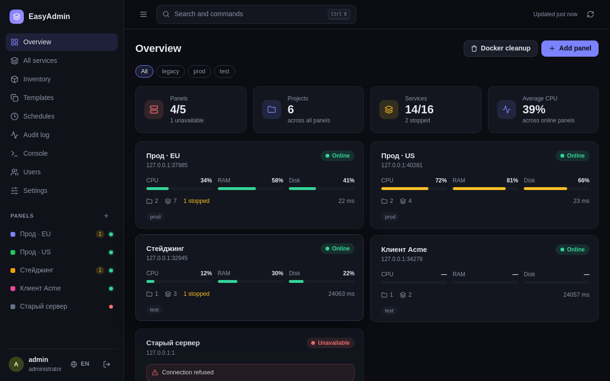
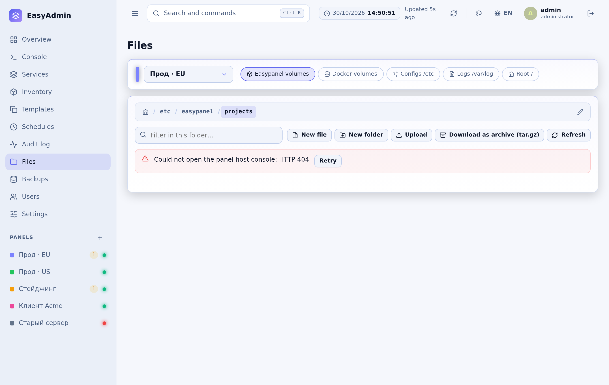
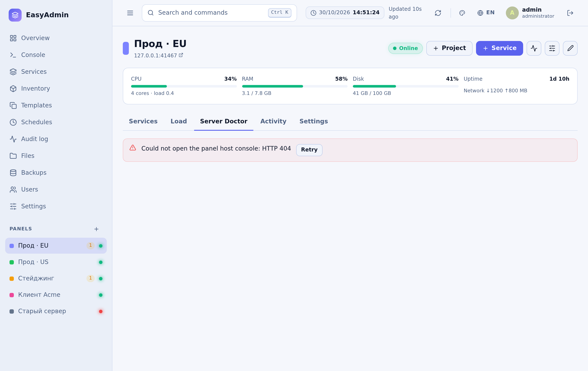
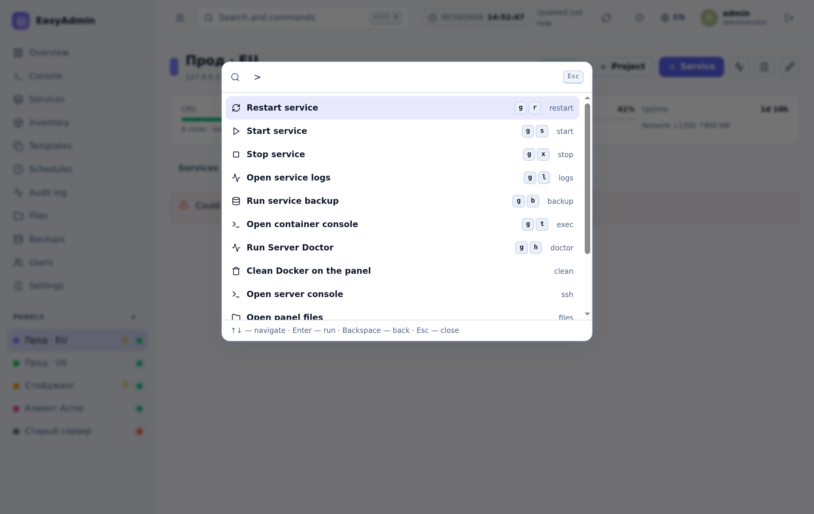
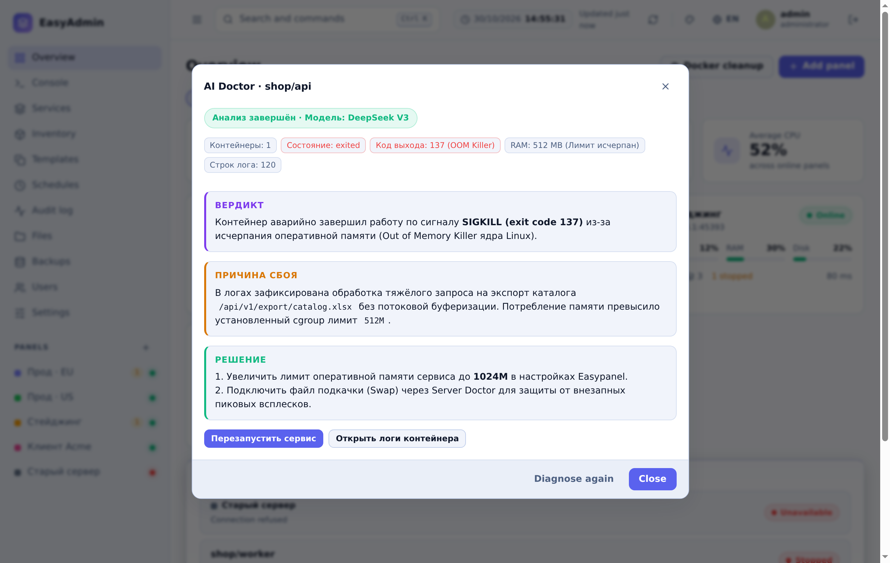
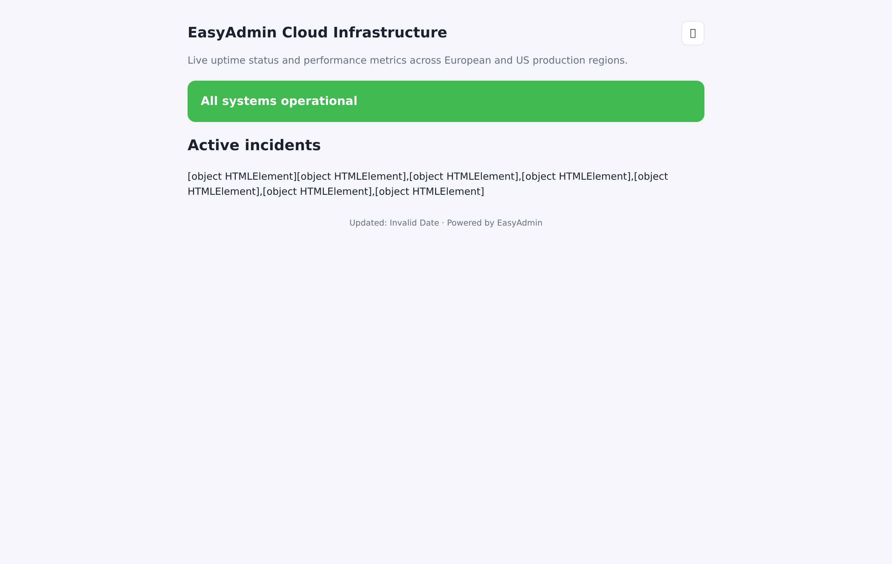
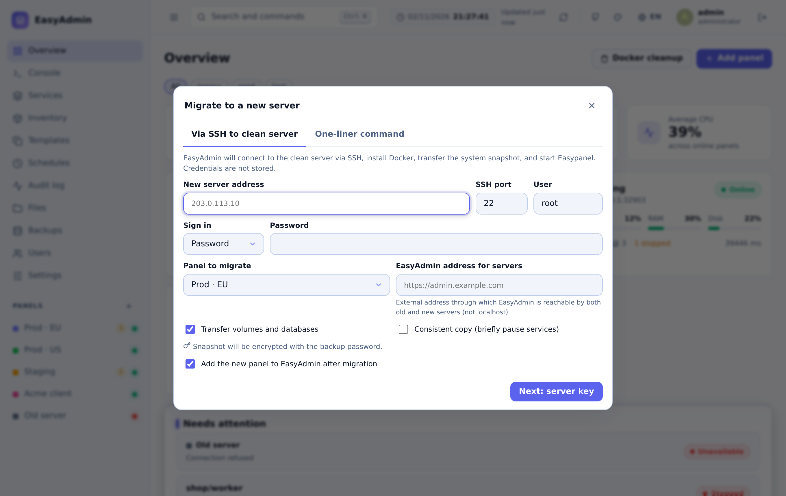
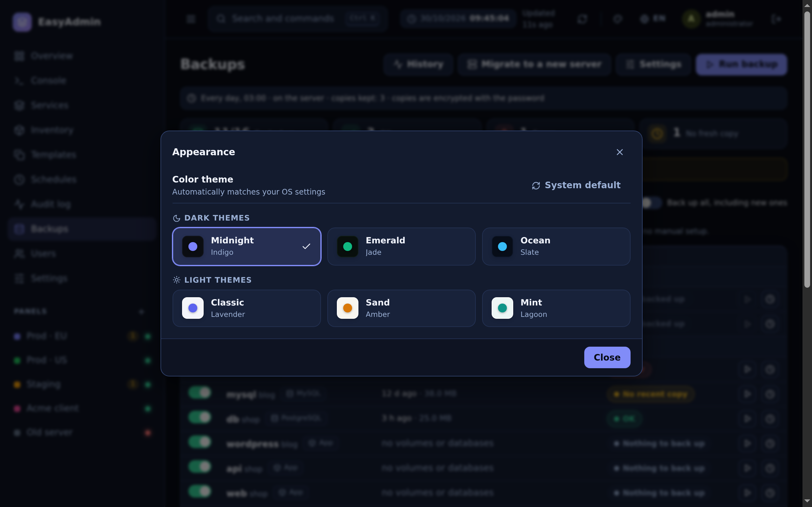
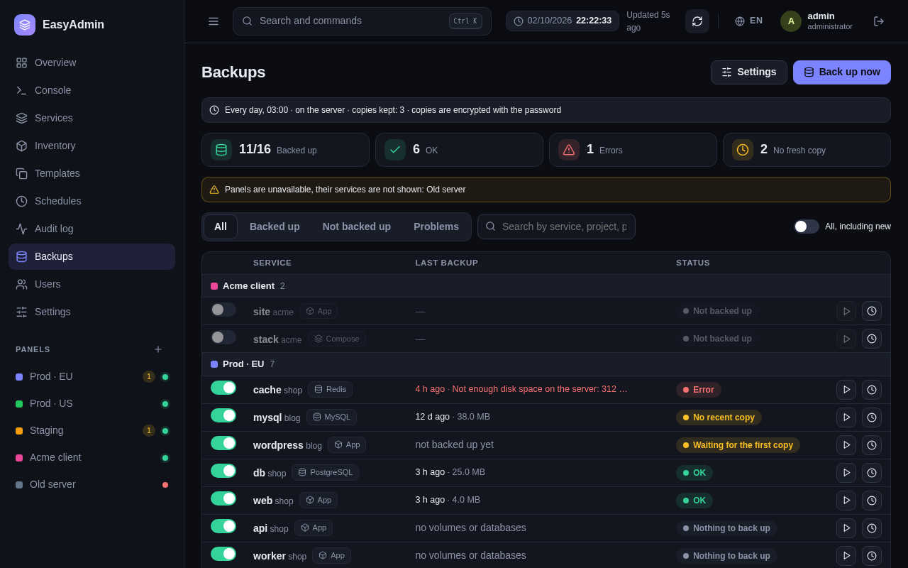
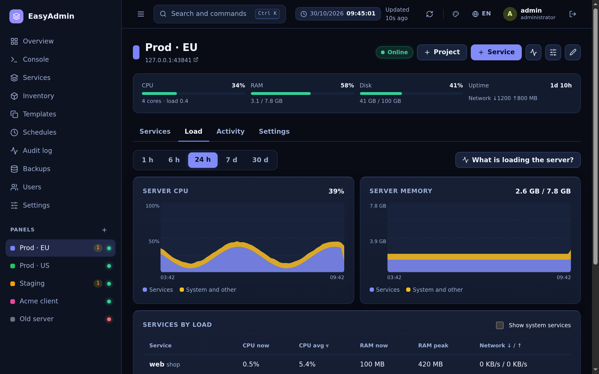

<div align="center">

# 🐴 EasyAdmin

### Единая панель управления кластерами [Easypanel](https://easypanel.io)

**Управляйте 10–50+ серверами Easypanel, Docker-кластерами, базами данных и файлами хоста из одного быстрого и удобного интерфейса.**  
Без runtime-зависимостей • Без сборки фронтенда • 100% Self-Hosted • Старт за 100мс • Потребление < 30 МБ RAM

[](LICENSE)
[](package.json)
[](Dockerfile)
[](#-архитектура-без-сборки)
[](#)
[](https://github.com/Its-My-Work/easyadmin)
[](README.md)

[**Демо**](#-интерактивное-демо) • [**Быстрый старт**](#-быстрый-старт-за-60-секунд) • [**Возможности**](#-возможности) • [**Файловый менеджер**](#-файловый-менеджер-хоста-и-ide-редактор) • [**Server Doctor**](#-server-doctor-и-оптимизация-диска) • [**Скриншоты**](#-скриншоты) • [**Безопасность**](#-безопасность)

</div>

> ⭐️ **Поставьте звёздочку репозиторию** — если EasyAdmin вам полезен или интересен, поддержите проект звездой на GitHub! Это помогает проекту расти и привлекать новых пользователей и разработчиков.

---

## 📸 Скриншоты

| Главный дашборд (Обзор) | Файловый менеджер хоста и IDE-редактор |
|:---:|:---:|
|  |  |

| Server Doctor и оптимизация диска | Командная палитра 2.0 (`Ctrl + K`) |
|:---:|:---:|
|  |  |

| AI Doctor (Диагностика сбоев в 1 клик) | Публичная страница статуса (Status Page) |
|:---:|:---:|
|  |  |

| Переезд на новый сервер в 1 клик | 6 встроенных тем оформления |
|:---:|:---:|
|  |  |

| Резервное копирование и история | Мониторинг нагрузки в реальном времени |
|:---:|:---:|
|  |  |

---

## ⚡ Зачем нужен EasyAdmin?

Easypanel отлично справляется с управлением отдельным сервером. Но когда у вас **3, 10 или 25+ серверов**, постоянное переключение вкладок, ввод паролей и рутинное обслуживание на каждом хосте отнимают слишком много времени.

**EasyAdmin объединяет все ваши инсталляции Easypanel в единый командный центр:**
- 🖥️ **Централизованный контроль**: Все сервисы, метрики CPU/RAM/Диска и статусы контейнеров со всех серверов на одном экране.
- 📁 **Файловый менеджер хоста**: Просмотр файлов сервера, IDE-редактор с боковым деревом и поиском `Ctrl+F`, скачивание архивов `.tar.gz` и drag-and-drop загрузка без открытия 22 порта наружу.
- 🧹 **Server Doctor**: Оценка здоровья хоста (A–F) с 1-click очисткой `journalctl`, безопасным Docker prune и добавлением Swap в один клик.
- 🤖 **AI Doctor**: Диагностика упавших контейнеров в 1 клик с очисткой паролей и секретов, анализом причины и готовым решением.
- 🚦 **Публичная Status Page**: Встроенная замена Uptime Kuma на `/status` с 90-дневной шкалой аптайма и SVG-бейджами для репозиториев.
- ⌨️ **Командная палитра 2.0 (`Ctrl + K`)**: Быстрый запуск в стиле Raycast/Linear с префиксами для команд (`>`), папок (`/`), серверов (`@`) и логов (`!`).
- 🚀 **Переезд серверов в 1 клик**: Бесшовный перенос всей инсталляции Easypanel на чистый VPS по SSH или через готовую curl-команду.
- 💾 **Шифрованные бэкапы по расписанию**: Автоматическое резервное копирование (`AES-256-GCM`) в S3, SFTP или локально.
- 🌍 **6 языков и 6 цветовых тем**: Полная локализация (RU, EN, ZH, DE, ES, PT) и 6 проработанных тем (3 тёмные, 3 светлые).
- 🪶 **Без сборки и без зависимостей**: Чистый Node.js и нативные ES-модули. Запуск за 100мс, потребление < 30 МБ RAM.

---

## ⏱️ Быстрый старт за 60 секунд

### 🚀 Вариант 1: Установка в 1 команду (Рекомендуется)

Выполните команду на чистом сервере или VPS с правами root:

```bash
curl -sSL https://raw.githubusercontent.com/Its-My-Work/easyadmin/main/install.sh | bash
```
*Скрипт сам проверит Docker, создаст `/opt/easyadmin/docker-compose.yml`, загрузит образ и запустит панель на порту 3100.*

---

### Вариант 2: Запуск через Docker Compose

Создайте файл `docker-compose.yml`:

```yaml
services:
  easyadmin:
    image: ghcr.io/its-my-work/easyadmin:latest
    container_name: easyadmin
    restart: unless-stopped
    ports:
      - "3100:3100"
    environment:
      - PORT=3100
      - DATABASE_PATH=/data/easyadmin.db
    volumes:
      - easyadmin_data:/data

volumes:
  easyadmin_data:
```

Запустите сервис:

```bash
docker compose up -d
```

Откройте `http://ip-вашего-сервера:3100`. Первый вошедший пользователь регистрирует учетную запись Главного Администратора.

---

### Вариант 2: Запуск напрямую через Node.js (>= 22.13)

```bash
git clone https://github.com/Its-My-Work/easyadmin.git
cd easyadmin
npm start
```

---

## 🎮 Интерактивное демо

Протестируйте возможности EasyAdmin локально в изолированной песочнице с тестовыми данными:

```bash
node scripts/demo.js
```

Откройте `http://localhost:3100` и войдите:
- **Логин:** `admin`
- **Пароль:** `demo12345`

---

## ✨ Возможности

### 📁 Файловый менеджер хоста и IDE-редактор
- **Root-доступ к хосту без SSH**: Работает через защищенный WebSocket-канал Easypanel (`/ws/hostShell`). Не требует открытия 22 порта наружу.
- **Быстрые закладки томов**: Мгновенный переход к томам проектов Easypanel (`/etc/easypanel/projects`), Docker volumes, `/etc`, `/var/log` и корню `/`.
- **Двухпанельный режим IDE (Split View)**: При клике на файл открывается сплит-интерфейс с **деревом файлов текущей папки слева** и редактором кода справа. Переключайтесь между файлами в 1 клик без закрытия редактора.
- **Поиск и замена в файле (`Ctrl + F` / `Ctrl + H`)**: Встроенная панель поиска со счетчиком совпадений (`1 из 12`), навигацией «▲ Вверх» / «▼ Вниз» (`Enter` / `Shift+Enter`), учетом регистра (`Aa`), заменой и автоматическим скроллом к найденной строке.
- **Инструменты сисадмина**: Номера строк, переключатель переноса строк (**Word Wrap**), быстрый переход к номеру строки (`Ctrl + G`), полноэкранный режим и предупреждение о несохраненных данных при переходе.
- **Архивы и загрузка**: Скачивание любой папки или файла архивом `.tar.gz` в 1 клик. Поддержка Drag-and-drop загрузки файлов.
- **Защита системных директорий**: Критические каталоги ядра хоста (`/`, `/bin`, `/boot`, `/etc`, `/usr`, `/var/lib/docker`) заблокированы от случайного удаления.

### 🧹 Server Doctor и оптимизация диска
- **Оценка здоровья хоста (A–F)**: Автоматическая диагностика заполнения диска, исчерпания inode, дефицита памяти и кэша Docker.
- **Исправление в 1 клик**:
  - `journalctl --vacuum-size=100M` — мгновенно освобождает до 5–20 ГБ раздутых системных логов.
  - `Docker Prune` — безопасная очистка устаревших слоев сборки и остановленных контейнеров.
  - `Swap в 1 клик` — создание и подключение файла подкачки (1G, 2G или 4G) для защиты VPS от зависаний при дефиците RAM.
- **Прозрачный статус и логи**: Анимация «Выполняется…» на кнопке во время работы и детальная карточка с реальным консольным выводом хоста (сколько байт освобождено).

### 🤖 AI Doctor (Диагностика сбоев в 1 клик)
- **Мгновенный анализ аварий**: Диагностика упавших контейнеров (`Exited (137)`, CrashLoopBackOff, OOM) в 1 клик.
- **Безопасность данных**: Встроенный санитайзер автоматически вырезает пароли, токены, IP-адреса и значения `.env` до отправки в модель.
- **Любой AI-провайдер**: Поддержка любого OpenAI-совместимого эндпоинта (OmniRoute, DeepSeek, OpenAI, Ollama, Groq).
- **Потоковый SSE-вывод и автопочинка**: Печатает вердикт в реальном времени с кнопками прямого действия (*Перезапустить*, *Подключить Swap*, *Открыть логи*).
- **Кэширование в SQLite**: Хэш ошибок кэшируется на 1 час — повторные сбои не тратят токены.

### 🚦 Встроенная публичная Status Page (Замена Uptime Kuma)
- **Публичный дашборд без авторизации**: Автономная страница статуса `/status` для клиентов и команды.
- **90-дневная история аптайма**: Интерактивные полоски дней с подсказками по процентам доступности и сбоям.
- **Управление инцидентами**: Публикация аварий и регламентных работ (*Под следствием*, *Причина найдена*, *Решено*).
- **Живые SVG-бейджи**: Готовые бейджи для вставки в репозитории и документацию (`/status/badge/:slug.svg`).
- **Защита от DoS**: In-memory кэш на 15 секунд с ETag и rate-лимитером по IP.

### ⌨️ Command Palette 2.0 (`Ctrl + K` пульт)
- **Управление без мыши**: Многошаговая командная строка в стиле Raycast / Linear.
- **Умные префиксы**:
  - `>` Команды управления (`> restart`, `> logs`, `> backup`, `> doctor`)
  - `/` Быстрый переход в папки файлового менеджера (`/ /var/log`)
  - `@` Выбор сервера / панели
  - `#` Фильтрация по проекту
  - `!` Просмотр логов контейнера
  - `:` Смена тем оформления и языка
  - `?` Шпаргалка по горячим клавишам

### 🚀 Переезд на новый сервер в 1 клик
- **Миграция без простоя**: Перенос проектов на новый хостинг или обновление VPS за пару минут.
- **Два режима работы**:
  1. **Прямое SSH-подключение**: EasyAdmin проверяет целевой сервер, накатывает Docker & Swarm, переносит зашифрованные данные и поднимает Easypanel автоматически.
  2. **Команда в 1 строку**: Генерация защищенной команды (`curl -sSL .../bootstrap.sh?token=... | bash`) для запуска от root на целевом сервере.
- **Полная идентичность**: Сохраняются все конфиги Easypanel, SSL-сертификаты Let's Encrypt, Git deploy-ключи, постоянные тома и базы данных.

### 🔔 Интерактивные алерты (Telegram и Discord)
- **Уведомления с кнопками действий**: Мгновенные оповещения при падении контейнеров или исчерпании диска.
- **Inline-кнопки прямо в чате**: Запуск `[ 🔄 Перезапустить ]`, `[ 📜 Логи (20 строк) ]`, `[ 🤖 AI Диагноз ]` и `[ 🔕 Заглушить 1ч ]` прямо со смартфона.
- **Криптографическая защита**: Каждая кнопка защищена HMAC-SHA256 подписью с защитой от повторов (nonce) и сроком жизни 15 минут.

### 🎨 6 встроенных тем оформления
- **3 тёмные темы**: Midnight (Индиго), Emerald (Хвойный нефрит) и Deep Ocean (Морской сланец).
- **3 светлые темы**: Classic (Лаванда), Warm Sand (Тёплый песок) и Mint Breeze (Морской бриз).
- **Быстрое переключение**: Клик по иконке палитры в шапке или горячие клавиши `Ctrl+K` -> `:`.

### 🌍 6 языков интерфейса
- Полная поддержка: **Русский**, **English**, **简体中文**, **Deutsch**, **Español** и **Português**.
- Автоматическое определение по языку браузера с возможностью ручного выбора в один клик.

---

## 🔒 Безопасность

- **Никаких открытых SSH-портов**: Работа с файлами и сервером ведется через шифрованный канал Easypanel WebSocket (`/ws/hostShell`).
- **Маскирование секретов**: Пароли, приватные ключи, токены и переменные окружения `.env` автоматически вырезаются из логов и запросов к AI.
- **Шифрование данных**: Все токены и ключи шифруются в локальной SQLite базе с помощью AES-256-GCM.
- **Ролевая модель (RBAC)**: Разграничение прав администратора, оператора и наблюдателя с привязкой к конкретным панелям.
- **Защита сессий**: HttpOnly cookie с проверкой происхождения запросов и защитой от CSRF.

---

## 🛠️ Архитектура без сборки

EasyAdmin строго следует философии Zero Build & Zero Dependencies:

```
┌────────────────────────────────────────────────────────┐
│                      EasyAdmin                         │
│                                                        │
│  Бэкенд:   Node.js (node:http, node:fs, node:sqlite)   │
│  Фронтенд: Нативные ES-модули + CSS-переменные        │
│  Runtime:  0 сторонних зависимостей в npm              │
│  Сборка:   0 шагов сборки (без Vite, Webpack, Babel)   │
└────────────────────────────────────────────────────────┘
```

- **Время холодного старта**: ~100 мс
- **Потребление памяти**: ~28 МБ RAM при стандартной нагрузке
- **Поставка**: Один сверхлегкий Docker-образ

---

## ⭐ Поддержите проект

Если EasyAdmin экономит ваше время и упрощает работу с серверами, пожалуйста, поставьте звёздочку репозиторию на GitHub — это лучшая поддержка автора и мотивация развивать проект дальше!

[](https://github.com/Its-My-Work/easyadmin)

---

## 📄 Лицензия

Проект распространяется под свободной лицензией **MIT**. Подробности в файле [LICENSE](LICENSE).
