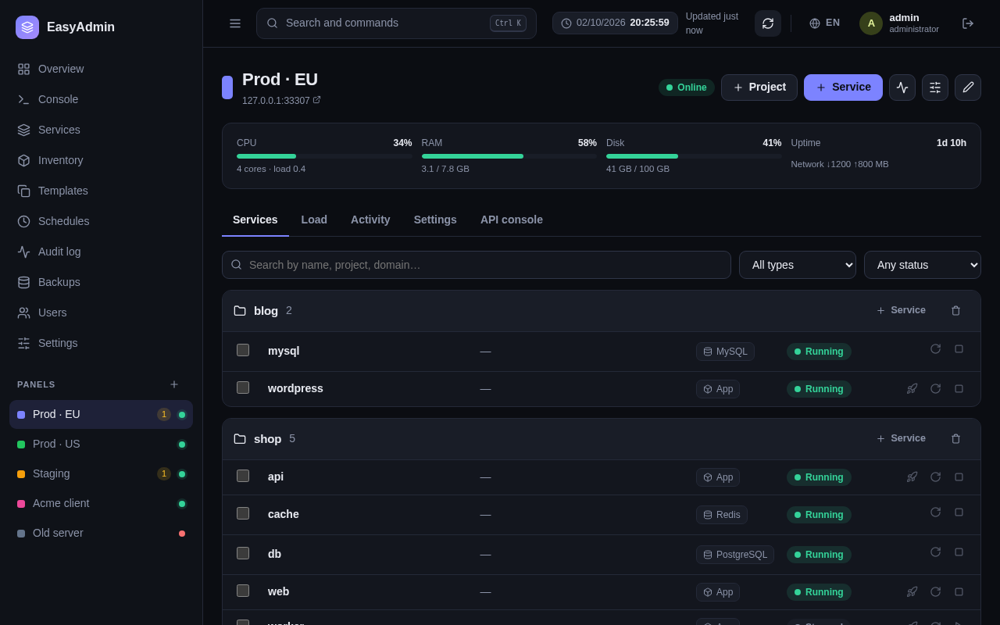

<div align="center">

# 🐴 EasyAdmin

### Единая панель управления кластерами [Easypanel](https://easypanel.io)

**Управляйте 10–50+ серверами Easypanel, Docker-кластерами, базами данных и сервисами из одного быстрого и удобного интерфейса.**  
Без runtime-зависимостей • Без сборки фронтенда • 100% Self-Hosted • Старт за 100мс • Потребление < 30 МБ RAM

[](LICENSE)
[](package.json)
[](Dockerfile)
[](#-архитектура-без-сборки)
[](#)
[](README.md)

[**Демо**](#-интерактивное-демо) • [**Быстрый старт**](#-быстрый-старт-за-60-секунд) • [**Возможности**](#-возможности) • [**Переезд**](#-переезд-на-новый-сервер-в-1-клик) • [**Скриншоты**](#-скриншоты) • [**Безопасность**](#-безопасность)

</div>

---

## 📸 Скриншоты

| Главный дашборд (Обзор) | Переезд на новый сервер в 1 клик |
|:---:|:---:|
|  |  |

| 6 встроенных тем оформления | Мониторинг нагрузки в реальном времени |
|:---:|:---:|
|  |  |

| Бэкапы и аварийное восстановление | Управление панелями и сервисами |
|:---:|:---:|
|  |  |

---

## ⚡ Зачем нужен EasyAdmin?

Easypanel отлично справляется с управлением отдельным сервером. Но когда у вас **3, 10 или 25+ серверов**, постоянное переключение между десятками вкладок браузера, раздельные сессии и рутинное повторение настроек становятся мучением.

**EasyAdmin объединяет все ваши серверы Easypanel в единый командный центр:**
- **Забудьте о десятках вкладок**: статус серверов, графики CPU, память и диски всех хостов видны на одном экране.
- **Переезд на новый сервер в 1 клик**: полный перенос сервера (Easypanel, SSL-сертификаты Let's Encrypt, Git deploy-ключи, тома данных и базы) на чистый сервер по SSH или одной curl-командой.
- **Единые бэкапы и мастер восстановления**: дампы баз (Postgres, MySQL, MariaDB, Mongo, Redis) и томов с шифрованием, ротацией в S3 и удобным пошаговым восстановлением.
- **Массовые операции**: одновременный перезапуск, массовое обновление переменных окружения (`.env`) и раскатка новых тегов образов сразу по нескольким серверам.
- **6 сочных тем оформления**: 3 тёмные (Полночь, Изумруд, Океан) и 3 светлые (Классическая, Песок, Мята) с быстрым переключением из шапки.
- **Встроенный веб-терминал (xterm.js)**: консоль контейнеров и root-терминал хоста прямо в браузере без открытых наружу портов SSH.
- **Ноль сборки и ноль раздувания**: написан на чистом современном Node.js (`node:sqlite`, `node:crypto`) и ванильных ES-модулях. Никакого Webpack, никаких сотен мегабайт `node_modules`.

---

## 🚀 Быстрый старт за 60 секунд

### Через Docker Compose (рекомендуется)

Создайте файл `docker-compose.yml`:

```yaml
services:
  easyadmin:
    image: ghcr.io/its-my-work/easyadmin:latest # или build: .
    container_name: easyadmin
    restart: unless-stopped
    ports:
      - "3100:3100"
    environment:
      - PORT=3100
      - HOST=0.0.0.0
      - EASYADMIN_SECRET=сгенерируйте_через_openssl_rand_hex_32
      - EASYADMIN_SECURE_COOKIES=false # Установите true при работе за HTTPS-прокси
    volumes:
      - ./data:/app/data
```

Запустите:

```bash
docker compose up -d
```

Откройте в браузере **`http://localhost:3100`**. При первом входе создайте учётную запись администратора и подключите первую панель Easypanel (по адресу и API-токену, либо через логин/пароль панели).

### Одной командой через Docker CLI

```bash
docker run -d \
  --name easyadmin \
  --restart unless-stopped \
  -p 3100:3100 \
  -v easyadmin_data:/app/data \
  -e EASYADMIN_SECRET="$(openssl rand -hex 32)" \
  node:22-alpine \
  sh -c "git clone https://github.com/Its-My-Work/easyadmin.git /app && cd /app && npm start"
```

### Напрямую через Node.js (версия ≥ 22.13)

```bash
git clone https://github.com/Its-My-Work/easyadmin.git
cd easyadmin
npm start # Откроется на http://localhost:3100
```

---

## 🎮 Интерактивное демо

Хотите протестировать интерфейс прямо сейчас без подключения боевых серверов? Запустите встроенный демо-режим с моками:

```bash
npm run demo
```

Откройте **`http://localhost:3100`** и войдите под `admin` / `demo12345`. Панель запустится с 5 виртуальными production-серверами, тестовыми сервисами, графиками нагрузки и бэкапами.

---

## ✨ Возможности

### 🤖 AI Doctor (Диагностика сбоев в 1 клик)
- **Мгновенный анализ причин аварий**: Диагностика упавших контейнеров (`Exited (137)`, CrashLoop, OOM) в 1 клик.
- **Безопасность данных**: Встроенный санитайзер автоматически вырезает пароли, токены, IP-адреса и значения `.env` до отправки в модель.
- **Любой AI-провайдер**: Поддержка любого OpenAI-совместимого эндпоинта (OmniRoute, DeepSeek, OpenAI, Ollama, Groq).
- **Потоковый SSE-вывод и автопочинка**: Печатает вердикт в реальном времени с кнопкой **«Применить решение»** (рестарт, добавление swap, очистка).
- **Кэширование в SQLite**: Хэш ошибок кэшируется на 1 час — повторные сбои не тратят токены.

### 🚦 Встроенная публичная Status Page (Замена Uptime Kuma)
- **Публичный дашборд без авторизации**: Автономная страница статуса `/status` для клиентов и команды.
- **90-дневная история аптайма**: Интерактивные полоски дней с подсказками по процентам доступности и сбоям.
- **Управление инцидентами**: Публикация аварий и регламентных работ (`Под следствием`, `Исправлено`).
- **Живые SVG-бейджи**: Готовые бейджи для вставки в репозитории и документацию (`/status/badge/:slug.svg`).
- **Защита от DoS**: In-memory кэш на 15 секунд с ETag и rate-лимитером по IP.

### 🧹 Server Doctor и оптимизация диска
- **Оценка здоровья хоста (A–F)**: Автоматическая диагностика заполнения диска, исчерпания inode и дефицита памяти.
- **Очистка системных логов в 1 клик**: `journalctl --vacuum-size=100M` мгновенно освобождает до 5–20 ГБ.
- **Добавление Swap в 1 клик**: Создание и монтирование Swap-файла (1G / 2G / 4G) для спасения VPS от зависаний.
- **Очистка Docker-кэша**: Безопасное удаление висячих слоев сборки без риска для рабочих данных.

### ⌨️ Command Palette 2.0 (`Ctrl + K` пульт)
- **Управление без мыши**: Многошаговая командная строка в стиле Raycast / Linear.
- **Умные префиксы**:
  - `> ` — Выполнение команд (`> restart`, `> logs`, `> backup`, `> doctor`).
  - `/ ` — Мгновенный переход по путям в файловом менеджере (`/ /etc/nginx`).
  - `@ ` — Фильтрация по серверам и панелям.
  - `# ` — Фильтрация по проектам.
  - `! ` — Быстрый просмотр логов.
  - `? ` — Шпаргалка по горячим клавишам.
  - `: ` — Быстрая смена темы и языка (`:theme dark`, `:lang zh`).

### 🔔 Интерактивные алерты Telegram и Discord
- **Управление авариями прямо из чата**: Поднимайте сервисы со смартфона в один тап.
- **Инлайн-кнопки действий**:
  - `[ 🔄 Перезапустить ]` — Рестарт упавшего контейнера прямо из Telegram.
  - `[ 📜 Логи (20 строк) ]` — Получить свежие строки логов сбоя.
  - `[ 🤖 AI Диагноз ]` — Запустить AI Doctor и прислать вердикт в чат.
  - `[ 🔕 Заглушить 1ч ]` — Временно отключить повторные уведомления по сервису.
- **Безопасность**: Действия подписываются одноразовыми HMAC-SHA256 токенами с защитой от replay-атак.

### 🌐 Мониторинг флота серверов
- **Глобальный обзор**: мгновенная сводка здоровья кластеров, статусы («В сети», «Деградация», «Недоступен»), CPU/RAM/Диск по всем серверам.
- **Фильтрация по тегам и быстрый поиск**: группировка серверов (`prod`, `staging`, `clients`), быстрый поиск по сервисам через `Ctrl+K` или `/`.
- **Очистка Docker**: массовая очистка неиспользуемых образов и кэша сборки на нескольких серверах в один клик.

### 🚀 Переезд на новый сервер в 1 клик
- **Бесшовный перенос инфраструктуры**: смена облачного провайдера или апгрейд хостинга за считанные минуты.
- **Два режима переноса**:
  1. **По SSH на чистый сервер**: EasyAdmin сам проверит хост (Ubuntu 22.04+ / Debian 11+), установит Docker и Swarm, скопирует зашифрованный слепок и запустит Easypanel.
  2. **Одной командой (Bootstrap-скрипт)**: EasyAdmin выдаст готовую одноразовую команду (`curl -sSL .../bootstrap.sh?token=... | bash`), которую достаточно выполнить на новом сервере от `root`.
- **Полная сохранность**: переносятся все манифесты Easypanel, SSL-сертификаты, Git deploy-ключи, тома с данными и базы (с опциональной паузой для согласованности).

### 🎨 6 встроенных дизайнерских тем
- **3 тёмные темы**:
  - 🌌 **Полночь (Индиго)**: строгий глубокий фон `#090c15` с неоновым фиолетово-синим акцентом.
  - 🌿 **Изумруд (Нефрит)**: хвойно-зелёный глубокий фон `#06110c` со свежим изумрудным сиянием.
  - 🌊 **Океан (Слейт)**: глубокий морской фон `#06101e` с ярким лазурным акцентом.
- **3 светлые темы**:
  - ☀️ **Классическая (Лаванда)**: чистый прохладный фон `#f5f7fc` с высокой контрастностью.
  - 🏜️ **Песок (Янтарь)**: тёплый кремовый фон `#f9f6ef` с благородным янтарным акцентом.
  - 🍃 **Мята (Лагуна)**: морской бирюзовый оттенок `#eef7f5` со свежим акцентом тила.
- **Быстрый переключатель**: иконка палитры в шапке для смены темы на лету, а также поддержка системной темы ОС.

### 💾 Резервные копии и восстановление
- **Резервирование баз и файлов**: дампы PostgreSQL, MySQL, MariaDB, MongoDB, Redis и архивы папок томов.
- **Хранение локально и в S3**: автоматическая выгрузка в AWS S3, Cloudflare R2, MinIO или Backblaze с ротацией.
- **Мастер восстановления**: восстановление в тот же сервис, другой существующий или создание нового сервиса-клона с автоматической страховочной копией перед перезаписью.
- **Единая «История»**: объединённый журнал запусков бэкапов и задач восстановления в одном окне.

### ⚡ Массовые операции и инвентарь
- **Сортировка таблиц**: интерактивная сортировка колонок (▲ / ▼) на страницах сервисов, бэкапов и пользователей.
- **Отдельная колонка «Проект»**: аккуратная структура сервисов с адаптивным скрытием на смартфонах.
- **Массовые правки `.env`**: пакетное добавление, изменение и удаление ключей конфигурации с сохранением комментариев.
- **Массовая смена тегов образов**: быстрое обновление версий контейнеров сразу по нескольким серверам.
- **Анализ расхождений и SSL**: контроль версий сервисов между кластерами и мониторинг сроков истечения сертификатов Let's Encrypt.

### 💻 Веб-консоли (xterm.js)
- **Терминал контейнера**: полноценный терминал внутри контейнера (nano, vim, htop, Tab, вставка из буфера).
- **Консоль хоста**: доступ к shell самого сервера через защищённую консоль Easypanel без необходимости открытия 22 порта в интернет.

### 🔒 Безопасность и контроль доступа
- **Разделение прав (RBAC)**:
  - `admin`: полный доступ к серверам, миграциям и пользователям.
  - `operator`: деплой, рестарт, правка env и доменов (без системных настроек и удаления серверов).
  - `viewer`: режим наблюдения без доступа к секретам и переменным окружения.
- **Аутентификация**:
  - **SSO (OpenID Connect)**: бесшовная интеграция с Authentik, Keycloak, Google Workspace, Azure AD, Okta.
  - **Двухфакторная аутентификация (2FA)**: поддержка TOTP (Google Authenticator, 1Password, Bitwarden).
  - **Шифрование токенов**: алгоритм AES-256-GCM для всех хранимых паролей и API-токенов.
  - **Аудит действий**: журнал операций с поиском и экспортом в CSV (хранение 90 дней).

---

## 🛠 Архитектура без сборки

В EasyAdmin принципиально нет сложного фронтенд-билдпайплайна:
- **Ноль npm-зависимостей** в рантайме: сервер работает исключительно на стандартных библиотеках Node.js (`node:sqlite`, `node:crypto`, `node:http`, `node:test`).
- **Без Webpack, Vite и Babel**: браузер загружает чистые нативные ES-модули (`import / export`).
- **Молниеносная скорость**: старт за ~100 мс, потребление менее 30 МБ оперативной памяти.

---

## ⚙️ Основные переменные окружения

| Переменная | Описание | По умолчанию |
|:---|:---|:---|
| `PORT` | Порт веб-сервера | `3100` |
| `HOST` | Сетевой интерфейс | `0.0.0.0` |
| `EASYADMIN_DATA` | Путь к постоянным данным | `./data` |
| `EASYADMIN_SECRET` | 32-байтный hex-ключ шифрования токенов | Генерируется в `data/secret.key` |
| `EASYADMIN_SECURE_COOKIES` | Безопасные cookies для HTTPS | `false` |
| `EASYADMIN_LANG` | Язык уведомлений по умолчанию (`ru` / `en`) | `ru` |
| `TZ` | Часовой пояс сервера для расписаний | `Europe/Moscow` |
| `EASYADMIN_METRICS_TOKEN` | Bearer-токен для метрик Prometheus `/metrics` | _Отключено_ |

---

## 🌐 Локализация

EasyAdmin полностью двуязычный:
- 🇷🇺 **Русский** (Основной)
- 🇬🇧 **English** (Полный интерфейс, серверные ошибки и логи: [README.md](README.md))

Переключение в один клик в шапке или на экране авторизации. Все строки централизованно хранятся в `public/js/i18n-dict.js` и валидируются тестами.

---

## 📄 Лицензия

Проект распространяется с открытым исходным кодом под лицензией [MIT License](LICENSE).
